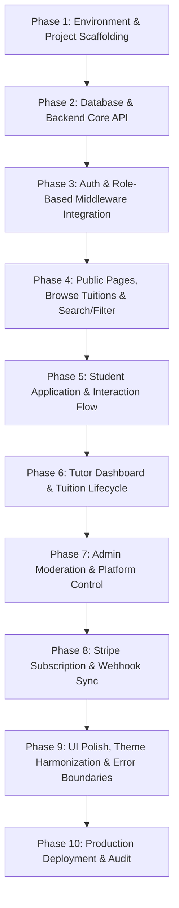

<!-- BEGIN:nextjs-agent-rules -->

## This is NOT the Next.js you know

This version has breaking changes — APIs, conventions, and file structure may all differ from your training data. Read the relevant guide in `node_modules/next/dist/docs/` (resolved from this file's directory; in monorepos the `next` package may not be visible from the repo root) before writing any code. Heed deprecation notices.

This block is written and re-added by `next dev` — verify at `node_modules/next/dist/server/lib/generate-agent-files.js`. Removing it from a diff only re-creates the uncommitted change; committing it with your work keeps the tree clean.

<!-- END:nextjs-agent-rules -->

# AGENTS.md — MentorLagbe Development Master Guide

This document serves as the single source of truth and comprehensive operational manual for AI coding agents and human developers building the **MentorLagbe** platform. Any AI agent working on this repository must read, understand, and strictly adhere to the guidelines, architectures, and design rules documented below.

---

## 1. Project Overview & Scope: What is MentorLagbe?

### 1.1 Purpose & Problem Statement
**MentorLagbe** is a full-stack, role-based EdTech tuition discovery, batch management, and 1-on-1 mentorship platform. In markets like Bangladesh and beyond, parents and students struggle to find verified, qualified tutors filtered by subject, academic class level, mode (Online vs. Offline), and monthly budget. Concurrently, skilled tutors lack a professional, streamlined system to showcase their credentials, publish structured batches, and manage applicant lifecycles. MentorLagbe bridges this gap within a cohesive, curated ecosystem.

### 1.2 The Three Stakeholder Personas
1. **Student**:
   - Discovers verified tuition listings using server-side search and multi-parameter filters.
   - Views tuition details and submits application requests (phone, preferred schedule, note).
   - Tracks application statuses in real time (`pending`, `accepted`, `rejected`) and can cancel pending applications.
   - Upgrades to **Student Pro Plan ($10)** via Stripe for priority booking perks.
2. **Tutor**:
   - Creates tuition listings with direct banner uploads via ImgBB.
   - Operates under plan limits: **Free Plan** allows up to 2 active listings; **Tutor Pro Plan ($15)** unlocks unlimited listings and verified badges.
   - Manages applicant pipelines (reviewing notes, accepting/rejecting candidates).
   - Manages personal listings with full CRUD and active/closed status toggling.
3. **Admin**:
   - Moderates incoming tuition listings (approving or rejecting before listings appear publicly).
   - Manages registered users and controls role privileges (`student`, `tutor`, `admin`).
   - Audits financial health by tracking Stripe subscription transactions and platform revenue metrics.

### 1.3 Core Data Entities & Logical Architecture
The database consists of **exactly 4 core MongoDB collections**:

| Collection | Managed / Updated By | Purpose | Key Schema Fields |
| :--- | :--- | :--- | :--- |
| **`users`** | BetterAuth / Profile Edit / Admin / Stripe Webhook | User accounts, auth credentials, role assignments, profile data, and subscription tier. | `_id`, `name`, `email`, `image`, `role` (`'student' \| 'tutor' \| 'admin'`), `phone`, `bio`, `plan` (`'free' \| 'pro'`), `createdAt` |
| **`tuitions`** | Tutor (Create/Edit/Delete) & Admin (Approve/Reject) | Tuition batch and 1-on-1 mentorship postings. | `_id`, `title`, `subject`, `classLevel`, `mode` (`'Online' \| 'Offline'`), `location`, `monthlyFee`, `daysPerWeek`, `bannerImage`, `description`, `tutorName`, `tutorEmail`, `approvalStatus` (`'pending' \| 'approved' \| 'rejected'`), `isActive`, `createdAt` |
| **`applications`** | Student (Submit/Cancel) & Tutor (Accept/Reject) | Student enrollment requests and booking pipeline. | `_id`, `tuitionId`, `tuitionTitle`, `subject`, `monthlyFee`, `tutorEmail`, `studentName`, `studentEmail`, `studentPhone`, `preferredSchedule`, `studentNote`, `status` (`'pending' \| 'accepted' \| 'rejected'`), `appliedAt` |
| **`payments`** | Stripe Checkout & Webhook Handler | Financial audit log for Pro subscription upgrades. | `_id`, `userEmail`, `userName`, `userRole`, `planName`, `amount`, `currency`, `transactionId`, `stripeSessionId`, `paymentStatus` (`'paid'`), `paidAt` |

---

## 2. Technology Stack & Package Architecture

### 2.1 Frontend Stack (`MentorLagbe-Client`)
- **Core Framework**: **Next.js 15+ (App Router)** with **TypeScript**. Provides Server-Side Rendering (SSR), Server Components (RSC) for dynamic SEO and performance, and route handlers.
- **Component & UI Styling**: **Tailwind CSS** paired with **Shadcn UI** (Radix UI primitives). Enables modular, accessible, highly customizable, and theme-compliant components without boilerplate clutter.
- **Icons**: **Lucide React**. Clean, tree-shakeable SVG icon library. (Note: Use the modern X icon for Twitter rebranding).
- **Client-Side Notifications**: **Sonner** or **React Hot Toast**. For consistent, non-blocking toast alerts across auth, CRUD, and checkout events.
- **Form Management & Validation**: **React Hook Form** + **Zod**. Ensures strict schema-based client-side validation before submission.
- **HTTP Client**: **Axios** or native typed `fetch` wrappers with interceptors for bearer token injection.

### 2.2 Backend Stack (`MentorLagbe-Server`)
- **Runtime & Framework**: **Node.js** with **Express.js** (TypeScript or clean ES modules).
- **Database Driver**: **MongoDB Native Driver** or **Mongoose ODM** for schema enforcement, indices, and aggregations.
- **Authentication**: **BetterAuth** with MongoDB Adapter, generating verified sessions and **JWT tokens** for cross-service API protection.
- **Security & Middlewares**:
  - `cors`: Configured with explicit production/client origins.
  - `helmet`: HTTP header hardening.
  - Custom JWT verification and role guards: `verifyToken`, `verifyStudent`, `verifyTutor`, `verifyAdmin`.
- **Payment Gateway**: **Stripe Node SDK** (`stripe`). Implements Stripe Checkout Sessions and secure Webhook signature verification (`stripe.webhooks.constructEvent`).
- **Media Uploads**: **ImgBB API** integration for multipart image uploads (banner images, avatars) without hosting overhead.

---

## 3. Frontend & Backend Development Blueprint

### 3.1 Frontend Page Structure
- **Public Routes**:
  - `/` (Home): Engaging Hero banner, 6 dynamic latest approved & active tuitions, "How MentorLagbe Works" visual step guide, Top Subjects / Platform Stats / Testimonial carousel, Pricing Tiers overview.
  - `/tuitions`: Server-side search & filtering grid (by Subject, Class Level, Mode), pagination controls.
  - `/tuitions/[id]`: Detailed tuition profile, tutor credentials, location/schedule, and modal Apply form (strictly disabled/hidden for non-students).
  - `/pricing`: Comparative breakdown of Free vs. Pro tiers for both Tutors ($15) and Students ($10), triggering Stripe checkout.
  - `/sign-up` & `/sign-in`: Clean role-based registration (`Student` vs. `Tutor`), credential login, social auth option.
  - `/payment/success` & `/payment/cancel`: Transaction status feedback with navigation back to relevant dashboards.
- **Dashboard Layout (`/dashboard/...`)**:
  - Unified responsive dashboard layout with collapsible navigation sidebar, top navigation bar, profile preview widget, and active role-based link guards.
  - **Student View (`/dashboard/student`)**:
    - `/dashboard/student` (Overview): Metrics (Total Applied, Accepted, Pending, Active Plan).
    - `/dashboard/student/my-applications`: Application table with dynamic status badges; ability to cancel applications that are still `pending`.
  - **Tutor View (`/dashboard/tutor`)**:
    - `/dashboard/tutor` (Overview): Metrics (Total Listings, Approved Listings, Total Applicants, Active Plan).
    - `/dashboard/tutor/post-tuition`: Post creation form with ImgBB upload and plan quota validation (Free = max 2).
    - `/dashboard/tutor/my-tuitions`: Listing management table with Admin approval state, full CRUD, and active/inactive toggle.
    - `/dashboard/tutor/applicants`: Applicant management table with student contact info, schedule preference, note, and Accept/Reject triggers.
  - **Admin View (`/dashboard/admin`)**:
    - `/dashboard/admin` (Overview): Platform health metrics (Total Users, Total Tutors, Pending Listings, Total Stripe Revenue).
    - `/dashboard/admin/users`: User table with role management switches (`student`, `tutor`, `admin`).
    - `/dashboard/admin/tuitions`: Moderation queue to Approve (`approved`) or Reject (`rejected`) incoming posts.
    - `/dashboard/admin/transactions`: Financial ledger displaying Stripe transactions, user emails, amounts, and dates.
  - **Shared Route**:
    - `/dashboard/profile`: Personal profile updates (Name, Phone, Bio, ImgBB Avatar upload).

### 3.2 Backend API Architecture
- `POST /api/auth/*`: BetterAuth endpoints for user registration, login, and session validation.
- `GET /api/tuitions`: Public list with query params `?search=&subject=&classLevel=&mode=&page=&limit=`. Returns only `approvalStatus: 'approved'` and `isActive: true`.
- `GET /api/tuitions/:id`: Public single tuition retrieval with tutor metadata.
- `POST /api/tuitions`: Protected (`verifyToken`, `verifyTutor`). Enforces 2-post quota for `free` plan tutors; saves as `pending`.
- `PATCH /api/tuitions/:id` & `DELETE /api/tuitions/:id`: Protected (`verifyToken`, `verifyTutor`). Restricts changes to post owner.
- `POST /api/applications`: Protected (`verifyToken`, `verifyStudent`). Enforces single active application per student per tuition.
- `GET /api/applications/student`: Protected (`verifyToken`, `verifyStudent`). Retrieves applicant's own submissions.
- `DELETE /api/applications/:id`: Protected (`verifyToken`, `verifyStudent`). Allows cancellation only when `status === 'pending'`.
- `GET /api/applications/tutor`: Protected (`verifyToken`, `verifyTutor`). Retrieves applicants for tutor's tuitions.
- `PATCH /api/applications/:id/status`: Protected (`verifyToken`, `verifyTutor`). Updates status to `accepted` or `rejected`.
- `PATCH /api/admin/tuitions/:id/status`: Protected (`verifyToken`, `verifyAdmin`). Updates status to `approved` or `rejected`.
- `GET /api/admin/users` & `PATCH /api/admin/users/:id/role`: Protected (`verifyToken`, `verifyAdmin`).
- `POST /api/payments/create-checkout-session`: Protected (`verifyToken`). Prepares Stripe Checkout session with metadata.
- `POST /api/payments/webhook`: Public with Stripe raw-body signature validation. Upgrades user to `plan: 'pro'` and stores transaction record.

---

## 4. Step-by-Step Implementation Roadmap



### Phase Details:
1. **Scaffolding**:
   - Establish clean Git repositories with meaningful initial commits.
   - Configure Tailwind with the required custom design palette.
   - Configure environment variables (`.env.local` on client, `.env` on server).
2. **Database & API Foundations**:
   - Connect to MongoDB with robust connection pooling.
   - Build seed scripts populating at least 10–12 realistic, connected tuition listings and test accounts.
3. **Authentication & Authorization**:
   - Setup BetterAuth, JWT issuance, and cookie/header persistence.
   - Implement `verifyToken`, `verifyStudent`, `verifyTutor`, and `verifyAdmin` Express middlewares.
   - Ensure page refreshes on protected client routes do not kick the user out to login.
4. **Public Interface**:
   - Build Navbar, Footer (with modern X icon), and responsive Hero section.
   - Develop `/tuitions` with debounced search and multi-select filter dropdowns.
   - Implement `/tuitions/[id]` with role-restricted Apply CTA.
5. **Dashboard Ecosystems**:
   - Create unified responsive layout with sidebar drawer for mobile view.
   - Complete Student, Tutor, and Admin sub-routes and verify permissions.
6. **Stripe & ImgBB Integrations**:
   - Implement ImgBB upload helper returning direct hosted URLs.
   - Integrate Stripe Checkout for Tutor ($15) and Student ($10) upgrades.
   - Test webhook events updating `users.plan` to `'pro'` and logging to `payments`.
7. **Verification & Hardening**:
   - Create custom `loading.tsx` skeletons, `not-found.tsx` (404), and `error.tsx` boundary.
   - Check CORS, route refresh behavior, and ensure zero runtime console errors.

---

## 5. Agent Operational Protocol & Working Rules

When operating as an AI coding agent on this codebase:
1. **No Destructive Overwrites**: Never blindly replace working files or erase existing configuration without reading and diffing first.
2. **Commit Discipline**:
   - Maintain a regular, granular commit pattern: **minimum 20 descriptive commits on client**, **minimum 12 descriptive commits on server**.
   - Commit messages must follow Conventional Commits format: `feat:`, `fix:`, `style:`, `refactor:`, `docs:`.
3. **Security Standards**:
   - Never commit API keys, MongoDB URIs, JWT secrets, or Stripe secret keys to Git.
   - Validate client inputs with Zod schemas and sanitize backend request parameters.
   - Check authorization on every sensitive server route via JWT payload validation.
4. **Environment Isolation**:
   - Client keys belong in `MentorLagbe-Client/.env.local` (prefixed with `NEXT_PUBLIC_` if public).
   - Server keys belong in `MentorLagbe-Server/.env`.
5. **Quality Verification**:
   - After building each feature, verify that route transitions succeed, data fetches handle empty/loading states gracefully, and toasts trigger on success or failure.

---

## 6. Project Architecture, Coding Standards & Workflow

### 6.1 Directory Conventions
```text
mentorLagbe/
├── MentorLagbe-Client/
│   ├── src/ (or app/)
│   │   ├── app/                    # Next.js App Router pages & route handlers
│   │   ├── components/
│   │   │   ├── ui/                 # Atomic Shadcn / Radix UI components
│   │   │   ├── common/             # Navbar, Footer, LoadingSkeleton, ErrorBoundary
│   │   │   ├── cards/              # TuitionCard, StatCard, TestimonialCard
│   │   │   └── dashboard/          # Sidebar, DashboardHeader, DataTables
│   │   ├── lib/                    # Auth client, Axios instances, utils (cn helper)
│   │   ├── hooks/                  # Custom React hooks (useAuth, useDebounce)
│   │   └── types/                  # Shared TypeScript interfaces & types
│   ├── public/                     # Static assets, branding graphics
│   └── .env.local
├── MentorLagbe-Server/
│   ├── src/
│   │   ├── config/                 # DB connection, Stripe, BetterAuth config
│   │   ├── controllers/            # Route business logic (tuition, user, application, payment)
│   │   ├── middlewares/            # verifyToken, verifyRole, errorHandler
│   │   ├── models/                 # Mongoose schemas / MongoDB collections
│   │   ├── routes/                 # Express route definitions
│   │   ├── utils/                  # ImgBB uploader, seed scripts
│   │   └── index.ts (or server.js) # Server entry point
│   └── .env
└── mwntorLagbe-Docs/               # Assignment documentation and assets
```

### 6.2 Coding Standards
- **Strict Typing**: Avoid `any` in TypeScript. Define explicit interfaces for `User`, `Tuition`, `Application`, and `Payment`.
- **Reusable Components**: Keep cards, modals, form inputs, and badges modular and DRY.
- **Server Component Utilization**: In Next.js App Router, leverage RSC for data fetching where feasible, using Client Components (`'use client'`) only when interactive state, hooks, or browser events are required.

---

## 7. UI/UX Design System & Responsive Rules

### 7.1 Visual Personality & Philosophy
MentorLagbe is designed as a **modern, premium, elegant, and clean EdTech marketplace**. It intentionally moves away from generic, clinical white templates and avoids muddy, unappealing layouts. It balances refined organic warmth with institutional credibility.

### 7.2 Core Design Principles
- **No Harsh Pure White**: Avoid stark `#FFFFFF` background washes across major sections. Use the soothing `#D9CBB5` oatmeal canvas or soft, warm cream card fills (`#EFE7DC`).
- **Consistent Typographic Hierarchy**:
  - Headings: Serif or modern geometric sans-serif with consistent weight and tracking.
  - Body: High-contrast legible text using Deep Forest Pine (`#344C43`) for crystal clarity.
- **Card Geometry & Rhythm**:
  - Uniform heights and widths for all tuition and service cards within a grid.
  - Generous padding (`p-6` or `p-8`), rounded corners (`rounded-2xl` or `rounded-xl`), and subtle, warm borders rather than heavy harsh drop shadows.
- **Social Media Compliance**: Always use the modern **X** icon (never the deprecated Twitter bird icon).
- **Responsive Fluidity**:
  - Breakpoints: Mobile (`<640px`), Tablet (`640px - 1024px`), Desktop (`>1024px`).
  - Mobile dashboards must feature an off-canvas drawer or collapsible toggle sidebar.
  - Tables must feature horizontal scroll wrapping (`overflow-x-auto`) on mobile devices.

---

## 8. Complete Color Palette & Application Mapping

The project design is anchored by an exclusive, hand-crafted four-color palette:

| Token Name | Hex Code | Visual Tone | Application & Usage Guidelines |
| :--- | :--- | :--- | :--- |
| **Primary** | `#668B78` | Earthy Sage Green | **Core Brand Color**: Primary CTA buttons ("Apply Now", "Search Tuitions", "Save"), active tab highlights, progress indicators, active navigation indicator bars, and primary links. |
| **Background** | `#D9CBB5` | Warm Oatmeal / Sand | **Base Canvas**: Global page body background, modal overlay backdrop tinting, subtle container section fills. Creates an organic, welcoming, and fatigue-reducing atmosphere. |
| **Dark Accent** | `#344C43` | Deep Forest Pine | **Contrast & Structure**: Primary headings (`h1`-`h4`), dark navigation bar headers, footer background, primary body copy, dashboard sidebar surface, and high-emphasis data table headers. |
| **Accent** | `#B87959` | Warm Terracotta / Clay | **Callouts & Highlights**: "Pro Plan" badges, "Featured" ribbons, promotional banner callouts, notification counters, pending status highlights, and secondary interactive emphasis. |

### 8.1 Supporting Neutral & Functional Tokens (Derived Harmoniously)
To maintain accessibility, readability, and contrast ratios:
- **Surface / Card Background**: `#EFE7DC` (Soft Sand Cream — clean surface for cards, dashboard widgets, and input fields sitting on the `#D9CBB5` background).
- **Subtle Border**: `rgba(52, 76, 67, 0.15)` (Soft Dark Accent tint for crisp, elegant dividers).
- **Status Badges**:
  - *Approved / Accepted*: Green tint (`bg-[#668B78]/15 text-[#344C43] border border-[#668B78]/30`)
  - *Pending*: Amber/Terracotta tint (`bg-[#B87959]/15 text-[#B87959] border border-[#B87959]/30`)
  - *Rejected / Inactive*: Muted rose/slate tint (`bg-red-500/10 text-red-700 border border-red-500/20`)

---

## 9. Final AI Agent Checklist Before Handing Off
- [ ] Requirements from `mentorLagbe-docs/docs.txt` fully integrated without omissions.
- [ ] All 4 MongoDB collections faithfully represented in backend and frontend models.
- [ ] Free vs. Pro business logic strictly enforced (Tutor 2-listing limit, Pro unlimited).
- [ ] Responsive navigation and dashboard layouts functional across all device widths.
- [ ] No unauthorized application flow: only authenticated students can apply for tuitions.
- [ ] ImgBB uploads functional on both Profile and Tutor Post Tuition pages.
- [ ] Stripe Checkout and Webhooks securely configured with plan updates.
- [ ] Zero hardcoded secrets in version control; proper `.env` configuration documented.
