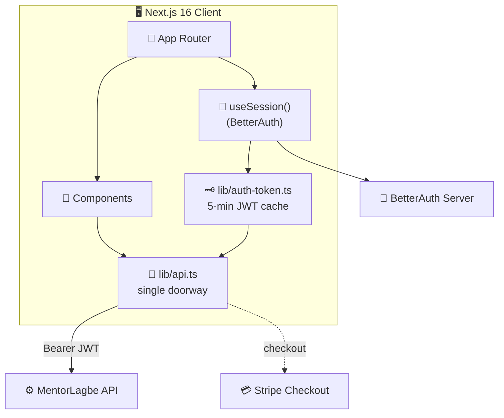

<div align="center">

# 🎨 MentorLagbe Client

**The Next.js frontend for MentorLagbe, a role-aware tutor discovery & tuition marketplace connecting verified mentors with students across Bangladesh.**

[](https://nextjs.org/)
[](https://react.dev/)
[](https://www.typescriptlang.org/)
[](https://tailwindcss.com/)
[](https://better-auth.com/)
[](./LICENSE)

🌐 **Backend:** [MentorLagbe-Server](https://github.com/aminulislamdev/Mentor-Lagbe-Server) · **Live API:** [mentor-lagbe-c.vercel.app](https://mentor-lagbe-c.vercel.app/)

</div>

---

## 🧭 Quick Navigation

| 🚀 Start | 🏗️ Build | 🎨 Design | 🛡️ Ship |
|---|---|---|---|
| [Overview](#-overview) | [Architecture](#%EF%B8%8F-architecture) | [Design System](#-design-system) | [Deployment](#%EF%B8%8F-deployment) |
| [Features](#-features) | [Project Structure](#-project-structure) | [Routing & Guards](#%EF%B8%8F-routing--role-guards) | [Performance](#-performance) |
| [Getting Started](#-getting-started) | [API Layer](#-api-layer) | [Auth Flow](#-authentication-flow) | [Contributing](#-contributing) |

---

## 🔍 Overview

MentorLagbe Client is a **Next.js 16 (App Router)** frontend with three role-aware dashboards: 🎒 **student**, 👨‍🏫 **tutor**, and 🧑‍⚖️ **admin**. It also includes a public marketplace for browsing tuition listings.

It talks to the MentorLagbe Server through one typed API layer that handles JWT attachment, token caching, and retry on `401`. Auth is handled by **BetterAuth**, and payments go through **Stripe Checkout**.

> ✏️ The design feels like a curated **identity desk**: serif headlines, mono metadata, and a warm earthy palette, not a generic SaaS dashboard.

---

## ✨ Features

### Public
- 🏠 **Landing page** with featured tuitions and tutor showcases.
- 🔎 **Tuition catalog** — browse, filter, and search listings with pagination.
- 👤 **Tutor profiles** — view bio, subjects, ratings, and active listings.
- 💬 **Contact** and **Pricing** pages.
- 🌗 **Dark / light theme** with system preference detection.

### Student
- 📋 **Student dashboard** — active applications, saved tuitions, plan status.
- ✍️ **Apply to tuitions** — one-click application with profile snapshot.
- 👤 **Profile management** — edit name, phone, bio, and portrait.

### Tutor
- 📚 **Tutor dashboard** — manage active listings, applications, and earnings.
- ➕ **Create tuition listings** — title, subject, mode (online/offline), fee, description.
- ✅ **Application management** — accept or reject student applications.
- 👤 **Profile management** — same identity desk shared across roles.

### Admin
- 🛡️ **Admin dashboard** — moderate content and approve tutors.
- 👥 **Tutor approval queue** — approve or reject pending tutor accounts.
- 📊 **Platform overview** — counts, recent activity.

### Platform
- 🔐 **BetterAuth JWT authentication** — asymmetric, no shared secret.
- 🎭 **Role-aware routing** — separate dashboards per role, enforced by route guards.
- 🎨 **Scoped design system** — CSS variables, Tailwind utilities, shared primitives.
- 🖼️ **Image optimization** — `next/image` with restricted remote patterns.
- 📱 **Responsive** — mobile-first layouts across every page.

---

## 🧰 Tech Stack

| Layer | Technology |
|---|---|
| ⚡ Framework | Next.js 16 (App Router, RSC) |
| ⚛️ Runtime | React 19 |
| 🟦 Language | TypeScript 5.x |
| 🎨 Styling | Tailwind CSS 4 + CSS variables |
| 🧱 UI Primitives | Custom components in `components/ui/` |
| 🖌️ Icons | Lucide React |
| 🔑 Auth | BetterAuth client SDK |
| 💳 Payments | Stripe Checkout + webhooks |
| 🔌 Data Fetching | Custom `apiFetch` wrapper over `fetch` |
| 📝 Forms | Native React state + typed validation |
| ☁️ Deployment | Vercel |

---

## 🏗️ Architecture



### 🔄 Request Lifecycle

1. 📞 A component calls `apiFetch<T>(path, options)` from `lib/api.ts`.
2. 🗝️ `apiFetch` uses a cached JWT (5-min TTL) or requests a fresh one.
3. 📨 The request goes out with `Authorization: Bearer <JWT>`.
4. 🔁 On `401`, the token is force-refreshed and the request is retried **once**.
5. 📦 The `{ success, data, message }` envelope is unwrapped into a typed `T`.
6. ❌ Errors throw a typed `ApiError` with status and message.

---

## 🚀 Getting Started

### 📋 Prerequisites

- ✅ **Node.js** ≥ 20.x
- ✅ **npm** ≥ 10.x *(or `pnpm` / `yarn`)*
- ✅ Access to the **MentorLagbe Server** (local or remote)
- ✅ A **BetterAuth** project with `BETTER_AUTH_URL` and `NEXT_PUBLIC_AUTH_URL` configured
- ➕ *(Optional)* A **Stripe** account for checkout testing

### 📥 Installation

```bash
# 1. Clone the repository
git clone https://github.com/aminulislamdev/Mentor-Lagbe-Client.git
cd Mentor-Lagbe-Client

# 2. Install dependencies
npm install

# 3. Set up environment variables
cp .env.example .env.local   # then fill in your values

# 4. Start the dev server
npm run dev
```

The site will be available at **http://localhost:3000**.

### 🔧 Environment Variables

<details>
<summary><b>👀 Click to view all variables</b></summary>

| Variable | Required | Description |
|---|:---:|---|
| `NEXT_PUBLIC_API_URL` | ✅ | MentorLagbe Server base URL |
| `NEXT_PUBLIC_AUTH_URL` | ✅ | BetterAuth client URL |
| `BETTER_AUTH_SECRET` | ✅ | BetterAuth secret *(server-only)* |
| `BETTER_AUTH_URL` | ✅ | BetterAuth base URL *(server-only)* |
| `MONGODB_URI` | ✅ | MongoDB connection *(BetterAuth storage)* |
| `STRIPE_SECRET_KEY` | ❌ | Stripe secret *(server-only)* |
| `NEXT_PUBLIC_STRIPE_PUBLISHABLE_KEY` | ❌ | Stripe public key |

</details>

> ⚠️ **Never prefix a secret with `NEXT_PUBLIC_`** unless it is safe to expose in the browser.

### ▶️ Running Locally

```bash
npm run dev         # 🔁 Dev server with hot reload
npm run build       # 🏗️ Production bundle
npm start           # 🏁 Serve the production build
npm run typecheck   # 🔍 TypeScript check (no emit)
npm run lint        # 🧹 ESLint
```

---

## 📜 Available Scripts

| Script | What it does |
|---|---|
| `npm run dev` | Dev server with hot reload (port 3000) |
| `npm run build` | Build the production bundle |
| `npm start` | Serve the production build |
| `npm run lint` | Run ESLint |
| `npm run typecheck` | Run the TypeScript compiler with `--noEmit` |

---

## 📂 Project Structure

```text
Mentor-Lagbe-Client/
├── 🧭 app/
│   ├── (public)/              # Public routes (landing, catalog, tutors)
│   ├── dashboard/
│   │   ├── student/           # 🎒 Student dashboard + guard
│   │   ├── tutor/             # 👨‍🏫 Tutor dashboard + guard
│   │   └── admin/             # 🧑‍⚖️ Admin dashboard + guard
│   ├── api/
│   │   └── auth/              # 🔑 BetterAuth route handlers
│   ├── layout.tsx             # Root layout (theme, fonts, providers)
│   └── globals.css            # Tailwind + CSS variables
├── 🧩 components/
│   ├── ui/                    # Primitives (button, input, label, panel)
│   ├── common/                # Shared UI (navbar, footer, loading-state)
│   ├── dashboard/             # Dashboard-specific components
│   └── marketing/             # Landing page sections
├── 🧰 lib/
│   ├── api.ts                 # Single API doorway (apiFetch, ApiError)
│   ├── auth.ts                # BetterAuth server config
│   ├── auth-client.ts         # BetterAuth client config
│   ├── auth-token.ts          # JWT cache (5-min TTL)
│   └── utils.ts               # cn() and misc helpers
├── 📐 types/
│   ├── tuition.ts             # Tuition DTOs
│   ├── user.ts                # User DTOs
│   └── application.ts         # Application DTOs
├── 📘 docs/
│   └── COMPONENT_GUIDE.md     # Component rules & conventions
├── 🖼️ public/                 # Static assets
├── ⚙️ next.config.ts
├── 🛂 middleware.ts           # Auth guard for /dashboard/*
├── 📦 package.json
└── 🧾 tsconfig.json
```

---

## 🔐 Authentication Flow

MentorLagbe uses **BetterAuth** to issue JWTs. The server verifies them against a JWKS endpoint, so **no shared secret is stored on the client.**

### 🔑 Sign-in
1. ✉️ User submits email and password on `/sign-in`.
2. 📡 The BetterAuth SDK posts to `/api/auth/sign-in`.
3. 🍪 BetterAuth returns a JWT in the session cookie.
4. 🗝️ `lib/auth-token.ts` caches it in memory (5-min TTL), and later `apiFetch` calls send it as `Authorization: Bearer`.

### 🚪 Sign-out
1. 🧹 `handleSignOut()` clears the cache via `clearJwtCache()`.
2. 📡 The SDK calls `/api/auth/sign-out`, which invalidates the session cookie.
3. 🏠 The user is redirected to `/`.

### 🔄 Session Refresh & Roles
- ♻️ On a `401`, `apiFetch` force-refreshes the token once. If that fails, the user goes to `/sign-in`.
- 🎭 `useSession()` returns `session.user.role` (`student` | `tutor` | `admin`), and dashboard layouts wrap content in role guards.
- 🛡️ A root `middleware.ts` protects `/dashboard/*` on the server.

---

## 🔌 API Layer

`lib/api.ts` is the **single doorway** to the backend. Components never call the API with a raw `fetch`.

```ts
import { apiFetch, ApiError } from "@/lib/api"

try {
  const tuitions = await apiFetch<Tuition[]>("/api/tuitions")
  // ✅ typed, envelope already unwrapped
} catch (err) {
  if (err instanceof ApiError) {
    console.error(err.status, err.message)
  }
}
```

**✨ What it handles for you:**
- 🔐 Automatic JWT attachment
- 🗝️ 5-minute token cache with force-refresh
- 🔁 Single retry on `401`
- 📦 Envelope unwrapping: `{ success, data, message }` → `T`
- ❌ Typed `ApiError` with `status`, `message`, and `errors`

---

## 🛡️ Routing & Role Guards

Route protection works at three layers:

1. 🛂 **Middleware** (`middleware.ts`): blocks unauthenticated `/dashboard/*` requests on the server.
2. 🧱 **Layout guards** (`app/dashboard/*/layout.tsx`): client-side role check with `useSession()`.
3. 🚧 **Component gates**: Edit, Delete, and Approve buttons appear only for the right role.

| Route | Role | Guard |
|---|---|---|
| `/` · `/tuitions` · `/tutors` · `/pricing` | 🌍 Public | — |
| `/sign-in` · `/sign-up` | 🌍 Public | — |
| `/dashboard/student/*` | 🎒 student | Middleware + layout |
| `/dashboard/tutor/*` | 👨‍🏫 tutor | Middleware + layout |
| `/dashboard/admin/*` | 🧑‍⚖️ admin | Middleware + layout |

---

## 🎨 Design System

The editorial look is a deliberate break from generic SaaS dashboards.

| Token | Color | Role |
|---|---|---|
| 🌲 Forest | `#344C43` | Primary |
| 🟤 Copper | `#B87959` | Accent |
| 📜 Paper | `#EFE7DC` | Background |

- ✒️ **Serif headlines, mono metadata**: a "printed identity card" feel.
- 🎛️ **Scoped CSS variables**: theme tokens live in `globals.css`.
- 🧩 **Shared primitives** over duplicated components. See [`docs/COMPONENT_GUIDE.md`](./docs/COMPONENT_GUIDE.md).

**📏 Component rules:**
- ❌ No barrel files (`index.ts`)
- ✅ Colocate styles with the component
- ✅ Use `cn()` for conditional classes
- ✅ Keep primitives small and compose at the page level

---

## ☁️ Deployment

The client is deployed on **Vercel**.

1. 📤 Push to `main` or open a PR: Vercel deploys automatically.
2. 🔑 Set all required environment variables in the Vercel dashboard.
3. 🔗 Confirm `NEXT_PUBLIC_API_URL` points to the production API.

| Setting | Value |
|---|---|
| Framework Preset | Next.js |
| Node Version | 20.x |
| Build Command | `npm run build` |
| Output Directory | `.next` *(default)* |

**🧾 Build notes:**
- ⚡ Next.js 16 builds with Turbopack by default.
- 🖼️ `next.config.ts` restricts remote image hosts. Add new hosts explicitly.
- 🛂 The root `middleware.ts` runs on the edge runtime, so keep it dependency-light.

---

## ⚡ Performance

- 🧩 **Server Components by default**: only interactive islands use `"use client"`.
- 🖼️ **Image optimization** with `next/image` and restricted `remotePatterns`.
- 🔤 **Font optimization** with `next/font` and `display: swap`.
- 📦 **Route-level code splitting** handled by the App Router.
- 🗝️ **JWT caching** removes redundant auth round-trips.
- ⏳ **Lazy-loaded heavy components** like modals and editors via `next/dynamic`.

**🎯 Lighthouse Targets**

| Metric | Target |
|---|:---:|
| ⚡ Performance | ≥ 90 |
| ♿ Accessibility | ≥ 95 |
| ✅ Best Practices | ≥ 95 |
| 🔎 SEO | ≥ 95 |

---

## 🧪 Testing

> 🚧 A test suite is planned. For now, verification is manual plus `npm run typecheck` and `npm run lint`.

- 🔬 **Unit:** `vitest` for `lib/api.ts`, `lib/auth-token.ts`, and pure helpers
- 🧩 **Component:** `@testing-library/react` for form validation and route guards
- 🎭 **E2E:** Playwright for sign-in → apply → sign-out

---

## 🤝 Contributing

Contributions are welcome! 🎉

1. 💡 **Open an issue** describing the bug or feature.
2. 🌿 **Fork** and branch: `git checkout -b feat/your-feature`
3. 📖 Follow the [Component Guide](./docs/COMPONENT_GUIDE.md).
4. ✅ Run `npm run typecheck` and `npm run lint` before pushing.
5. 📬 **Open a PR** with a clear description and a linked issue.

**Commit convention:** `feat:` · `fix:` · `chore:` · `docs:` · `refactor:` · `test:`

**🧑‍💻 Code style:**
- 🟦 TypeScript strict mode
- 🚫 No `any`: use `unknown` and narrow it
- 🧩 Prefer Server Components; use `"use client"` only when needed
- 🎨 Colocate styles, and don't add global CSS without a scope

---

## 📄 License

Licensed under the **MIT License**. See the [LICENSE](./LICENSE) file for details.

---

## 📬 Contact

| | |
|---|---|
| 👤 **Author** | Aminul Islam |
| 💻 **Repository** | [github.com/aminulislamdev/Mentor-Lagbe-Client](https://github.com/aminulislamdev/Mentor-Lagbe-Client) |
| 🔗 **Backend** | [MentorLagbe-Server](https://github.com/aminulislamdev/Mentor-Lagbe-Server) |
| 🌐 **Live API** | [mentor-lagbe-c.vercel.app](https://mentor-lagbe-c.vercel.app/) |
| 🐛 **Issues** | [Open an issue](https://github.com/aminulislamdev/Mentor-Lagbe-Client/issues) |

---

<div align="center">

<sub>💙 Built with care for the MentorLagbe community.</sub>

</div>